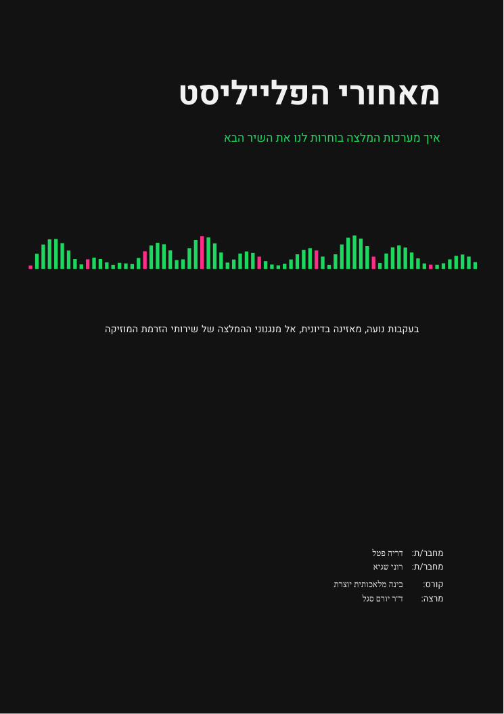
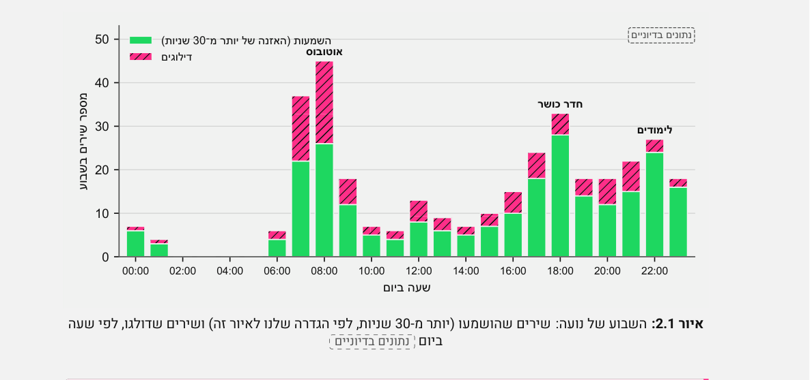
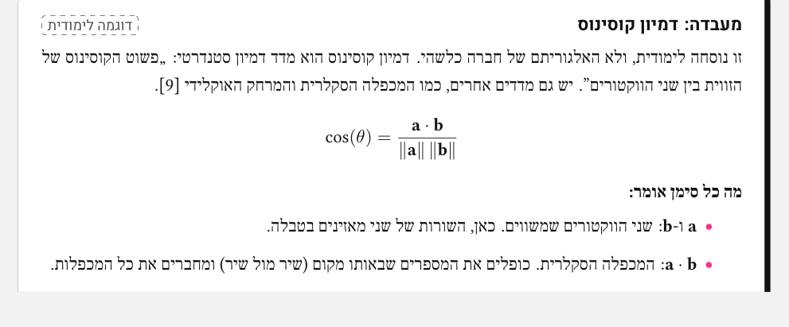
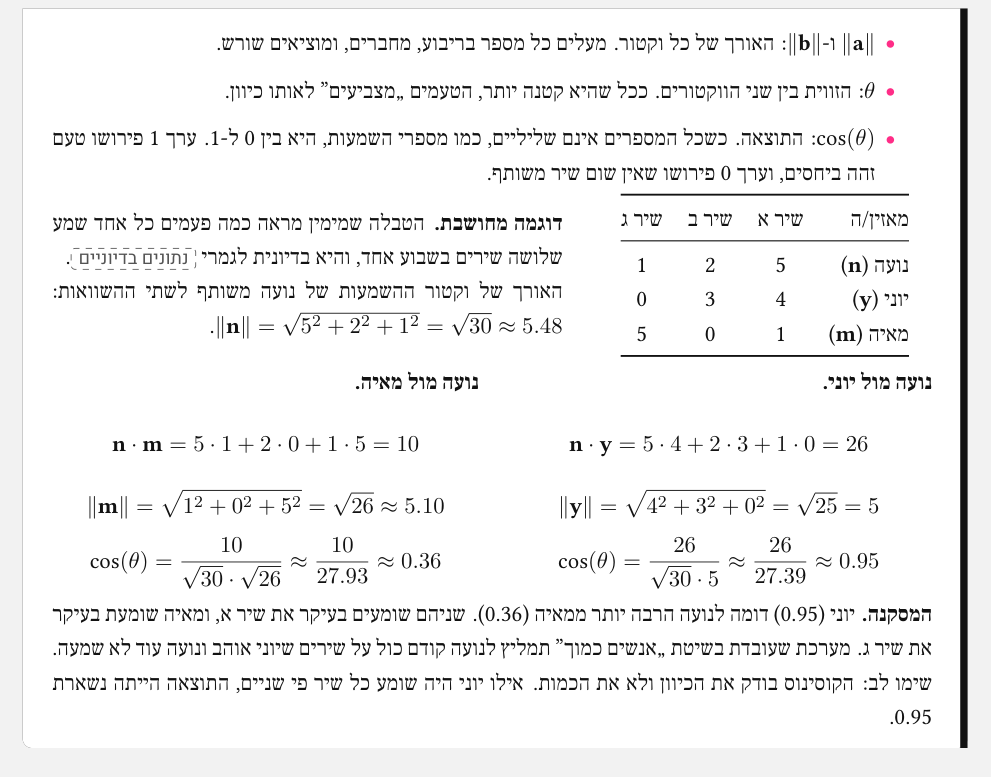
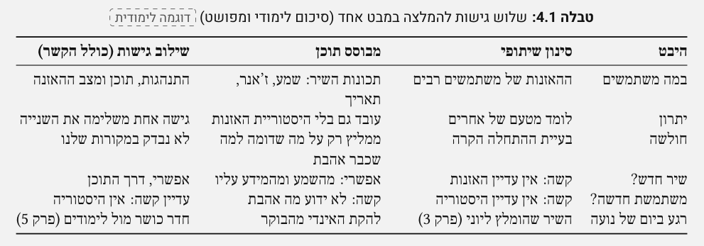
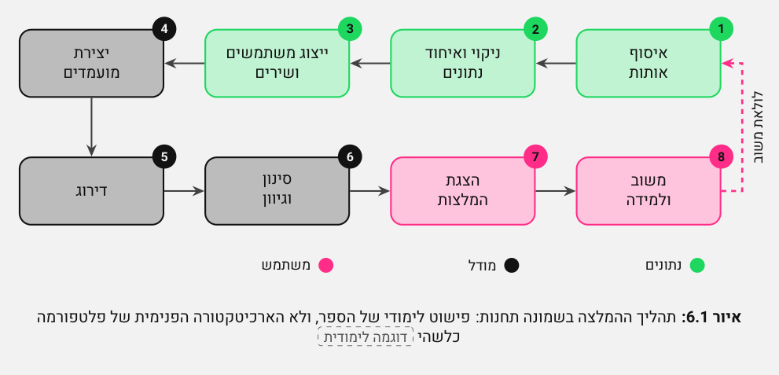
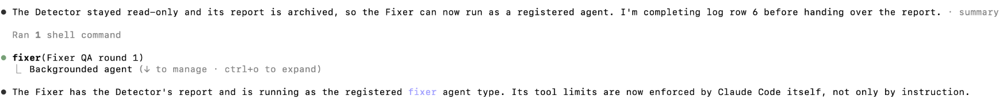
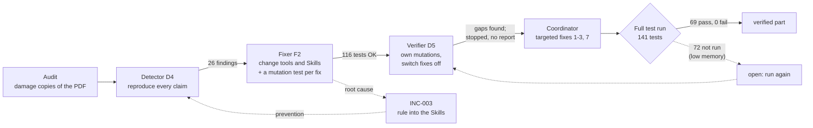

<div dir="rtl">

# מאחורי הפלייליסט

**איך מערכות המלצה בוחרות לנו את השיר הבא**: ספר עיון קצר (20 עמודים) בעברית, שנכתב כפרויקט בקורס „בינה מלאכותית יוצרת".

הספר מסביר בשפה פשוטה איך פועלות מערכות המלצה למוזיקה. הוא מלווה את **נועה**, מאזינה בדיונית, ברגעים יומיומיים: האוטובוס של הבוקר, חדר הכושר, לילה של לימודים וסיכום השנה. כל רגע פותח מנגנון אחד: אותות ודילוגים, סינון שיתופי, המלצה מבוססת תוכן, הקשר וחקירה, תהליך ההמלצה בשמונה תחנות, ובועות, גיוון והוגנות.

**קהל היעד:** סטודנטים ומאזינים סקרנים בלי רקע טכני או מתמטי מעבר לתיכון.

📄 **הספר (PDF):** [pdf/behind-the-playlist.pdf](pdf/behind-the-playlist.pdf)

> **מהדורה ציבורית.** בעותק הזה הוסרו מעמוד השער מספרי תעודת הזהות ושורת „תאריך הגשה”. שאר הספר זהה לגרסה שהוגשה. קובצי ההגשה עצמם אינם חלק מהמאגר הציבורי.

> **בדיוני ולימודי.** נועה, החברים שלה יוני ומאיה, וכל הנתונים שלהם בדיוניים, כולל נתוני הגרף בפרק 2 ([figures/data/noa_week.csv](figures/data/noa_week.csv)). בספר הם מסומנים בתגיות „בדיוני" ו„נתונים בדיוניים". הנוסחה ותרשים שמונה התחנות הם פישוטים לימודיים, ולא האלגוריתם או הארכיטקטורה של Spotify או של חברה אחרת. טענות על פלטפורמות מיוחסות במפורש למה שהחברה עצמה פרסמה.

## צילומי מסך מתוך ה־PDF הסופי

צילומי עמודי הספר נוצרו אוטומטית מהקובץ הסופי בעזרת `tools/screenshots.py`. צילום השער לקוח מהמהדורה הציבורית, שבה אין מספרי תעודת זהות ואין תאריך הגשה.

| | |
|---|---|
| **שער** (עמ' 1, מהדורה ציבורית)<br> | **גרף Python**: איור 2.1, השבוע הבדיוני של נועה (עמ' 7)<br> |

**נוסחה מוסברת עם דוגמה מספרית**: תיבת „מעבדה: דמיון קוסינוס" (עמ' 8–9)




**טבלת השוואה**: טבלה 4.1, שלוש גישות להמלצה (עמ' 11)



**תרשים שמונה התחנות** (TikZ, אובייקטים וקטוריים הניתנים לעריכה): איור 6.1 (עמ' 14)



## רשימת דרישות

מספרי העמודים נלקחו מה־PDF הסופי (`docs/screenshots/pagemap.json`).

| דרישה | מיקום / מצב |
|---|---|
| PDF מ־LaTeX עם עברית מימין לשמאל | ✅ LuaLaTeX + babel עם מחלקה ייעודית [book/behind-the-playlist.cls](book/behind-the-playlist.cls) (גרסה 1.0); כל 20 העמודים נבדקו, כולל בדיקת סדר אותיות ברמת הגליף בתרשים, בגרף, בטבלה ובשער |
| שער | ✅ עמ' 1 |
| תקציר | ✅ עמ' 2 |
| תוכן עניינים | ✅ עמ' 3 |
| פרקים | ✅ פרקים 1–8, עמ' 4–18 (1: עמ' 4 · 2: עמ' 6 · 3: עמ' 8 · 4: עמ' 10 · 5: עמ' 12 · 6: עמ' 14 · 7: עמ' 16 · 8: עמ' 18) |
| ביבליוגרפיה | ✅ עמ' 19–20: 18 מקורות מאומתים (13 שעברו ביקורת עמיתים, ספר אחד ו־4 עמודים רשמיים). כותרת עברית, ורשומות באנגלית משמאל לימין |
| גרף שנוצר ב־Python | ✅ איור 2.1, עמ' 7 ([figures/noa_week.py](figures/noa_week.py)) |
| טבלה | ✅ טבלה 4.1, עמ' 11 (וגם טבלת הנתונים הבדיונית בעמ' 9) |
| נוסחה + הסבר + דוגמה מספרית | ✅ דמיון קוסינוס, עמ' 8–9: כל סימן מוסבר, ו־0.95 מול 0.36 מחושבים צעד אחר צעד |
| תרשים בן שמונה בלוקים ב־TikZ | ✅ איור 6.1, עמ' 14 ([book/figures/pipeline.tex](book/figures/pipeline.tex)), עם הסבר לכל תחנה בעמ' 14–15 |
| צבעים, טיפוגרפיה ותיבות הדגשה עקביים | ✅ ארבעה סוגי תיבות („סצנה", „בקצרה", „מעבדה", „רגע, זה אמיתי?") ופלטה אחת: פחם `#121212`, ירוק `#1ED760`, ורוד `#FF2E88` ורקע בהיר `#F2F2F2`. הכול מוגדר ב־[book/style.sty](book/style.sty). כל הטקסט בעמודי הקריאה בצבע פחם; הירוק והוורוד משמשים רק למילויים, לקווים ולגרף. |
| היקף של כ־20 עמודים | ✅ 20 עמודים בדיוק, בלי עמודים מרופדים |
| README עם צילומי מסך מה־PDF הסופי | ✅ הקובץ הזה |
| PRD | ✅ [PRD.md](PRD.md) |
| יומן פרומפטים | ✅ [docs/prompts.md](docs/prompts.md) (ציטוט מילולי; מספרי ת״ז הושחרו בפרומפט 12, עם סימון מפורש) |
| עדות לשלושה סוכנים | ✅ ראו להלן |

## הסוכנים: תפקידים, תרומה בפועל ועדויות



צילום מתוך הרצת Claude Code. סוכן הבדיקה (Detector) סיים את הסריקה והעביר את הדוח לסוכן התיקון (Fixer).

הסוכנים הוגדרו בתיקייה [.claude/agents/](.claude/agents/) והורצו בכלי ה־Agent המובנה של Claude Code, תחת החשבון הקיים. הסוכן הראשי („Boss") תכנן, כתב תדריכים, עיצב, בנה את ה־PDF, בדק כל פלט ותיעד. כל ההרצות מתועדות ב־[docs/agents/log.md](docs/agents/log.md).

| סוכן | תפקיד | מה עשה בפועל | עדויות |
|---|---|---|---|
| **Researcher** | איתור ואימות מקורות | הרצה אחת (R1): 61 פתיחות דפים ו־7 חיפושים. אימת את כל 12 המקורות המועמדים שצוינו בשם, החליף את המועמד הכללי „הצהרות Spotify” בשני עמודים רשמיים של Spotify והוסיף 4 מקורות, כך שהתקבלו 18 מקורות. מיפה 45 טענות לפרקים, עם הפרדה בין „שיטה כללית" ל„טענת פלטפורמה", ותיעד פערים. | [משימה](docs/agents/tasks/R1-researcher.md) · [פעולות](docs/agents/transcripts/R1-researcher-actions.md) · [תמליל](docs/agents/transcripts/R1-researcher.jsonl) · [research-notes](docs/agents/research-notes.md) · [references.bib](book/references.bib) |
| **Writer** | כתיבת הטקסט העברי | שתי הרצות: W1 (תקציר ופרקים 1–4) ו־W2 (פרקים 5–8). השתמש רק בטענות מתוך הערות המחקר, והשמיט טענות שלא היה להן מקור. | [משימה W1](docs/agents/tasks/W1-writer.md) · [פעולות W1](docs/agents/transcripts/W1-writer-actions.md) · [משימה W2](docs/agents/tasks/W2-writer.md) · [פעולות W2](docs/agents/transcripts/W2-writer-actions.md) |
| **Reviewer** | ביקורת עובדות, מתמטיקה, עברית ועימוד | שתי הרצות. V1: נמצאו 36 בעיות (5 מהותיות), והוחלט על „נדרשים שינויים". V2: בדיקה ממוקדת אחרי התיקונים. כל המהותיות אומתו כמתוקנות ונמצאו 6 הערות קלות, וההחלטה הסופית הייתה **APPROVE WITH MINOR NOTES**. | [review-01](docs/agents/review-01.md) · [תגובה](docs/agents/review-01-response.md) · [review-02](docs/agents/review-02.md) · [תגובה](docs/agents/review-02-response.md) · [פעולות V1](docs/agents/transcripts/V1-reviewer-actions.md) · [פעולות V2](docs/agents/transcripts/V2-reviewer-actions.md) |

ההערות הקלות מ־review-02 תוקנו לאחר מכן בידי ה־Boss בלבד, ולא נערך סבב ביקורת שלישי.

## בקרת איכות (סבב 2, 25.11.2026)

ביקורת עצמאית מצאה שכלי ה־QA אישר PDF גם כשתוכן הוסתר או נמחק. התיקון נעשה בכלים וב־Skills, בלי לשנות את הספר או את ה־PDF.

- **סוכנים שהורצו:** Detector (D4) ו־Fixer (F2) הושלמו. סוכן האימות D5 **נעצר לפני שכתב דוח**; הפערים שמצא בפרטיות, בלוגים, בתוצאות ישנות ובהגנת הטסטים תוקנו בידי המתאם, בלי אימות עצמאי נוסף.
- **תוצאות:** הרצה מלאה של הקוד הסופי לא הושלמה: היא נעצרה בגלל זיכרון נמוך במחשב, אחרי ש־69 בדיקות עברו ו־0 נכשלו; 72 בדיקות לא רצו. באימות ממוקד קודם עברו 88 בדיקות מוטציה ו־2 בדיקות קיימות. בפרויקט האמיתי: 107 עברו, 0 נכשלו, 5 לא נבדקו או לא רלוונטיות.
- **מגבלות:** לא נבדק לוג LaTeX אמיתי, וכיסויים קטנים מאוד עדיין אינם מתגלים.

[דוח הסבב והמגבלות](docs/qa/round-02/README.md) · [תחקיר INC-003](docs/incidents/INC-003-qa-passes-invisible-content.md) · [רשימת ה־Skills](SKILLS.md) · [פרומפט היישום](prompts/qa-round-02-01-implementation.md)

<div dir="ltr">

```bash
python -m unittest discover -s tests     # about 10 minutes or more
python tools/qa/qa_lib.py --pdf pdf/behind-the-playlist.pdf --no-log --checks all --out build/qa
```

</div>

## Beyond Standard QA – Creative Engineering Approach

**השאלה שהנחתה אותנו:** לא „האם הספר עובר את הבדיקות?", אלא „האם הבדיקות היו נכשלות אילו הספר היה שבור?". בדיקות מוטציה, השוואה לרינדור ותחקיר תקלות הן שיטות מוכרות בהנדסת תוכנה. החידוש שלנו צנוע: הפנינו אותן אל כלי ה־QA של ספר LaTeX דו־כיווני, ובדקנו גם את ה־Detector עצמו.

**דוגמה מהממצאים בפועל ([D4](docs/qa/round-02/detect/detector-report.md)):** כלי ה־QA הקודם קרא בעיקר את שכבת הטקסט של ה־PDF. כשכיסינו כל עמוד במלבן לבן, הקורא כבר לא ראה דבר, אבל הכלי דיווח **‏55 עברו, 0 נכשלו, קוד יציאה 0**. גם כיסוי של השער, של גרף 2.1 או של טבלה 4.1 עבר בלי הערה. ה־Detector של סבב 1 לא יכול היה לגלות זאת, כי הריץ את הבדיקות רק על PDF תקין, ושם בדיקה עיוורת ובדיקה תקינה נראות אותו דבר.

| כלי | הערך ההנדסי | מה הוכח בפועל |
|---|---|---|
| **בדיקות מוטציה** | כל בדיקה מוכיחה שהיא **נכשלת** על עותק פגום, ולא רק עוברת על הספר התקין | 25 הטסטים החדשים של השלב האחרון, על הקוד שלפני התיקון: 17 נכשלו. 5 מתוך 5 תיקונים שבוטלו בכוונה התגלו |
| **QA חזותי** | בודק מה שהקורא רואה ברינדור: נראות של כל תו, צבעי האיורים וטביעת עמוד מול ה־PDF המאושר | הכיסויים מהדוגמה נכשלים כעת. כיסויים קטנים מאוד עדיין עוברים |
| **אימות עצמאי** | סוכן נפרד תוקף את התיקון במוטציות משלו, ולא רק מריץ את טסטי ה־Fixer | ה־Fixer דיווח 116 טסטים תקינים, וסוכן האימות D5 עדיין מצא פערים בפרטיות, בלוגים ובתוצאות ישנות. **D5 נעצר לפני שכתב דוח** |
| **תחקיר שורש** | מסביר למה המנגנון נכשל, ולא רק מה תוקן | [INC-003](docs/incidents/INC-003-qa-passes-invisible-content.md): הלקח של INC-002 („כל בדיקה צריכה טסט שלילי") נכתב בדוח, אבל לא נאכף ב־Skill או בטסט. עכשיו הוא חלק מה־Skills של ה־Detector וה־Fixer |

<div dir="ltr">



</div>

**מה הושלם ומה לא:**
- **הושלם:** כל השלבים בתרשים עד ההרצה המלאה. ההרצה המלאה האחרונה נעצרה בגלל זיכרון נמוך: **69 עברו, 0 נכשלו, 72 לא הושלמו**. לכן אין עדיין הרצה מלאה של הקוד הסופי.
- **לא אומת:** התיקונים האחרונים לא אומתו בידי סוכן עצמאי. גם לוג LaTeX אמיתי, Linux ו־macOS לא נבדקו.
- **כל הפרטים והמגבלות:** [דוח הסבב](docs/qa/round-02/README.md).

## בנייה

**סביבה שנבדקה:** macOS 14 (Intel) עם TeX Live 2026 (BasicTeX). הגופנים מצורפים לפרויקט בתיקייה [book/fonts/](book/fonts/SOURCES.md), תחת רישיון OFL 1.1, ולכן הבנייה אינה תלויה בגופני מערכת:
- Frank Ruhl Libre: טקסט עברי
- Heebo: כותרות
- Libertinus Serif: אנגלית ונטוי

תאימות ל־MiKTeX טרם נבדקה.

<div dir="ltr">

```bash
# 1. TeX: BasicTeX 2026 (https://mirror.ctan.org/systems/mac/mactex/BasicTeX.pkg), then:
sudo tlmgr --repository https://ctan.mirror.norbert-ruehl.de/systems/texlive/tlnet install \
  biblatex biber biblatex-ieee tcolorbox tikzfill pdfcol environ trimspaces titlesec \
  enumitem csquotes zref latexmk

# 2. Python environment (graph + checks + screenshots)
python3 -m venv .venv && .venv/bin/pip install --only-binary=:all: -r requirements.txt

# 3. Build the book: graph -> lualatex -> biber -> lualatex (via latexmk) -> automated checks
make pdf          # -> build/behind-the-playlist-lualatex.pdf

# 4. After approval: rebuild, regenerate README screenshots, copy to submission/
make submission   # -> submission/behind-the-playlist.pdf

# Without make (the sequence from the assignment), run inside book/:
#   lualatex main.tex && biber main && lualatex main.tex && lualatex main.tex
```

</div>

התוצרים:
- `build/behind-the-playlist-lualatex.pdf`
- `pdf/behind-the-playlist.pdf` (המהדורה הציבורית שבמאגר)
- `docs/screenshots/*.png`
- `build/lualatex/pages/page-NN.png`, תמונה של כל עמוד

הבדיקות האוטומטיות (`tools/check_pdf.py`) מוודאות שאין שגיאות, אין תווים חסרים, אין שורות גולשות, אין הפניות שבורות ואין טקסט לבן על רקע בהיר.

**גרסאות:**
- TeX: LuaHBTeX 1.24 (TeX Live 2026), biber 2.22, biblatex-ieee 1.4g, latexmk 4.89.
- Python 3.13, matplotlib 3.11.2. ב־matplotlib 3.11 העברית מוצגת מימין לשמאל בלי python-bidi. החבילה מותקנת, אבל השימוש בה הופך את האותיות.

**היסטוריה:** עד 2026-11-18 הספר נבנה ב־XeLaTeX עם `book/style.sty`. ה־PDF האחרון של אותה גרסה נשמר מקומית בתיקייה `backups/`.

## מבנה הפרויקט

<div dir="ltr">

```text
book/            main.tex, behind-the-playlist.cls (class v1.0), chapters/00–08, figures/ (noa_week.pdf, pipeline.tex),
                 references.bib, fonts/ (OFL fonts + licences), style.sty (retired XeLaTeX design)
figures/         noa_week.py + data/noa_week.csv (FICTIONAL data for Fig. 2.1)
tools/           check_pdf.py, screenshots.py, transcript_actions.py
docs/            prompts.md, outline.md, screenshots/, agents/ (brief, log, research notes, reviews, tasks, transcripts)
.claude/agents/  researcher.md, writer.md, reviewer.md
pdf/             behind-the-playlist.pdf (public edition: no student IDs, no submission date)
PRD.md · Makefile · requirements.txt
tests/           Hebrew RTL / style / diagram smoke tests; QA mutation tests
```

</div>

## התפתחות הפרויקט

בנינו אב־טיפוס של הספר על סמך ההנחיות שקיבלנו בשיעור. לאחר שהמרצה פרסם את המפרט המלא, השווינו את הפרויקט לדרישות ועדכנו את תוכנית העבודה בהתאם.

ההשוואה המלאה לדרישות: [docs/assignment-compliance.md](docs/assignment-compliance.md) · תוכנית העבודה: [PLAN.md](PLAN.md) · רשימת המשימות: [TODO.md](TODO.md) · יומן התקלות: [docs/incidents/](docs/incidents/README.md)

## מסמכים

- [PRD.md](PRD.md): היקף, תוצרים, עיצוב וקריטריוני קבלה
- [docs/prompts.md](docs/prompts.md): יומן הפרומפטים המלא
- [docs/outline.md](docs/outline.md): מתווה הספר שאושר
- [docs/agents/log.md](docs/agents/log.md): יומן הרצות הסוכנים

## מגבלות ידועות

- עמוד 13 מלא רק בכרבע, כי זה סוף פרק 5 וכל פרק נפתח בעמוד חדש. מילוי העמוד היה מחייב ריפוד.
- מונחים באנגלית בסוגריים עשויים להישבר בין שורות.
- תאימות ל־MiKTeX טרם נבדקה.

</div>
